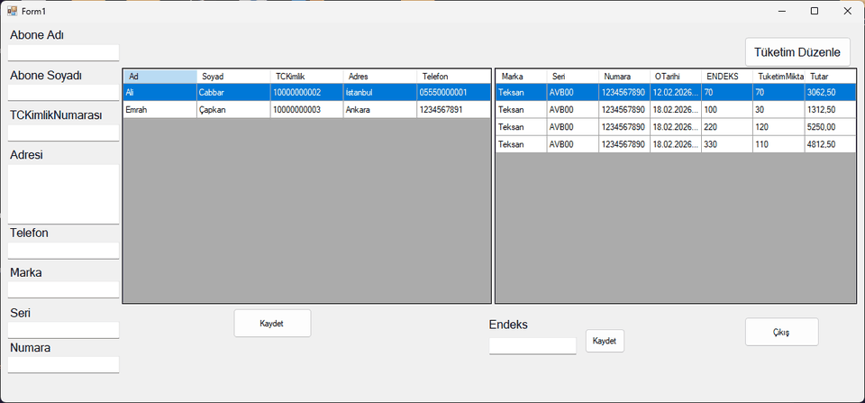
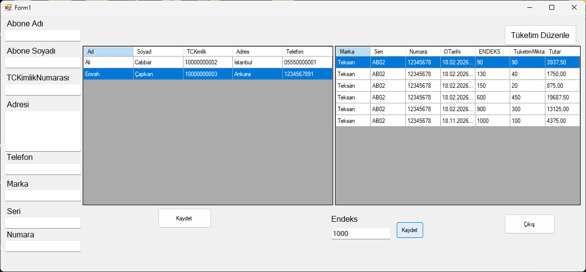
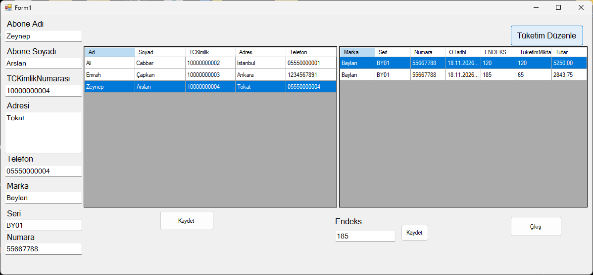

# 💧 Su Tahsilat Otomasyonu


Su abonelerinin, sayaçlarının ve sayaç okumalarının (tüketim) takibi için hazırlanmış otomasyon. Aynı konunun **iki farklı yaklaşımla** yazılmış iki sürümü vardır:

| Klasör | Yaklaşım | Teknoloji |
| --- | --- | --- |
| [`SuTahsilat-StoredProcedure`](SuTahsilat-StoredProcedure) | İş mantığı veritabanında: **6 stored procedure + 1 trigger** | .NET Framework 4.7.2, EF 6 (Database First) |
| [`SuTahsilat-CodeFirst`](SuTahsilat-CodeFirst) | **Katmanlı mimari** (DAL / BLL / UI), **EF Core Code First + Migration** | .NET 10 |

---

## 🎬 Demo



**Stored procedure sürümü:** yeni sayaç okuması girilince `trg_TuketimHesapla` tüketimi ve vergiler dahil tutarı hesaplıyor; yeni abone + sayaç kaydı ve iki okuma; **Tüketim Düzenle** (cursor) aynı sonucu veriyor.

| Yeni okuma: 100 m³ → 4.375,00 TL | Yeni abone ve okumaları |
| --- | --- |
|  |  |

> Code First sürümünün arayüz katmanı henüz geliştirilmediği için demo stored procedure sürümünden alınmıştır.
>
> Görüntüler, depodaki kurulum script'iyle kurulan örnek veritabanı üzerinde uygulama çalıştırılarak alınmıştır.


## 1️⃣ SuTahsilat-StoredProcedure

### Özellikler
- Abone kaydı (ad, soyad, TC Kimlik, adres, telefon) ve sayaç bilgisi (marka, seri, numara) (`sp_AboneKaydet`)
- Abone listesi; aboneye tıklayınca tüketim geçmişi (`sp_AboneListe`, `sp_TuketimListele`)
- Endeks (sayaç okuması) girişi (`sp_TuketimKaydet`)
- **Trigger ile otomatik tüketim hesabı:** `trg_TuketimHesapla`, yeni okuma eklenince aynı sayacın bir önceki okumasını bulur ve aradaki farkı tüketim olarak yazar; ilk okumada tüketim endekse eşittir.
- Tüm tüketimleri yeniden hesaplama (`spTumTuketimDuzenle`)

### Veritabanı (`SUTAHSILAT`)
`ABONELER`, `SAYACLAR`, `TUKETIM`, `UCRET` (birim fiyat ve vergi oranları)

### Kurulum
1. SSMS 22'de `SuTahsilat-StoredProcedure/Veri Tabanı/SUTAHSILAT.sql` dosyasını açıp **Execute (F5)**'e basın.
2. `SuTahsilat-StoredProcedure/App.config` içinde `data source=.\SQLEXPRESS` kullanılır.
3. `SuTahsilat.slnx` dosyasını Visual Studio ile açıp **F5** ile başlatın.

> `Veri Tabanı/Sorgular/SUTAHSILAT_ilk_script.sql`: ders sırasında yazdığım, açıklama satırlı orijinal script.

---

## 2️⃣ SuTahsilat-CodeFirst

Aynı alanın **katmanlı mimari** ile yeniden kurgulandığı sürüm.

```
SuTahsilat-CodeFirst/
├── SuTahsilat.DAL/   ← Entity'ler (Abone, Sayac, Tuketim, Tarife, Ucret), DbContext, Migrations
├── SuTahsilat.BLL/   ← İş katmanı: DbServiceBase, TarifeService (varsayılan tarifeleri ekler)
└── sutahsilatUI/     ← Windows Forms arayüz katmanı
```

- Veritabanı **Code First** ile oluşturulur: `20260304130237_InitialCreate` migration'ı
- `SuTahsilatDBContextFactory` (`IDesignTimeDbContextFactory`) ile tasarım zamanında migration desteği
- Bağlantı ayarı (`Server=.\SQLEXPRESS;Database=SuTahsilat_BGrubu`): çalışma zamanı için `SuTahsilat.BLL/Common/DatabaseSettings.cs`, migration komutları için `SuTahsilat.DAL/Context/SuTahsilatDBContextFactory.cs`

> **Durum:** Veri ve iş katmanları hazır; arayüz katmanı henüz geliştirilmedi (boş form).

### Kurulum
1. `SuTahsilatB.slnx` dosyasını Visual Studio 2026 ile açın (.NET 10 gerekir).
2. **Tools → NuGet Package Manager → Package Manager Console**'u açın, *Default project* olarak `SuTahsilat.DAL`'ı seçip çalıştırın:
   ```powershell
   Update-Database
   ```
   Komut, `.\SQLEXPRESS` üzerinde veritabanını migration'dan oluşturur.
3. **F5** ile başlatın.

---

**Gereksinimler:** Visual Studio 2026 (*.NET masaüstü geliştirme*) · SQL Server (Express yeterli) · SQL Server Management Studio (SSMS) 22

```bash
git clone https://github.com/GencayCeliker/Su-Tahsilat-Otomasyonu.git
```

> Örnek verilerdeki TC Kimlik ve telefon numaraları gerçek değildir.

## 📄 Lisans

Bu proje [MIT](LICENSE) lisansı altında sunulmuştur.
